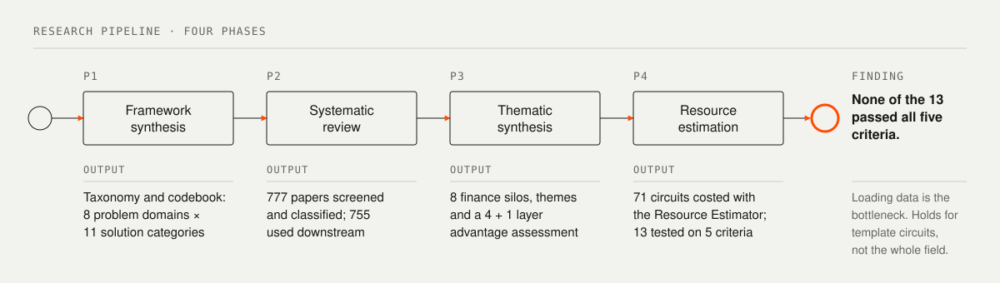
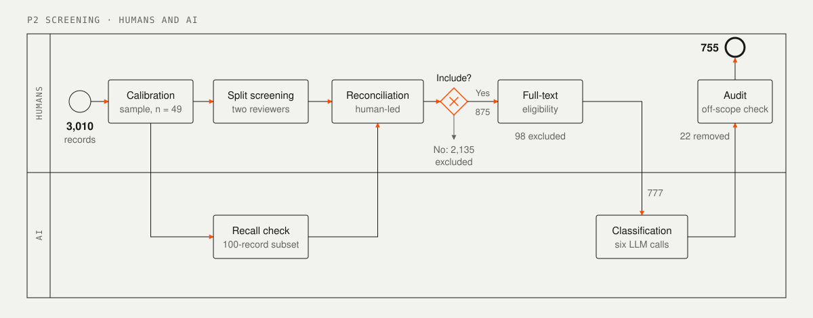
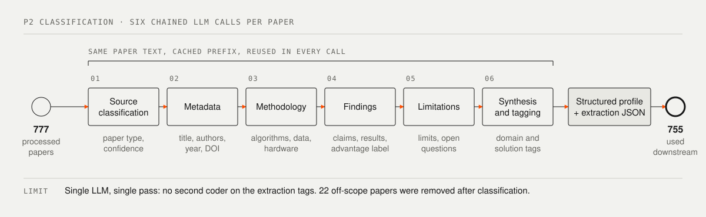

# Practical Quantum Advantage in Finance

Does gate-based quantum computing give finance a practical advantage yet? Not yet. Loading classical data is the bottleneck, not the algorithms.

> [!NOTE]
> This is the complete supplementary archive of our MSc thesis *Quantum Computing in Financial Services* (Copenhagen Business School, 2026). The [`submission/`](submission/) folder is a byte-for-byte copy of the archive published on Zenodo.
> The Zenodo record is the final, citable version: [](https://doi.org/10.5281/zenodo.20179194)

## Why it exists

Many papers say that quantum algorithms will speed up portfolio optimisation, pricing or risk. Most of these claims count only the core algorithm. They often leave out the cost of getting classical data into the quantum computer. We wanted to know if the claims still hold when that cost is counted.

## The finding

We ran Azure's Quantum Resource Estimator on 71 circuits from the literature. The 13 closest to the papers' own designs were tested against five criteria for practical advantage, including the cost of loading data. None passed all five. This holds for template versions of the circuits; it is not a proof for the whole field.

The Resource Estimator ran on Azure Linux VMs. No job ran on quantum hardware.

<picture>
  <source media="(prefers-color-scheme: dark)" srcset="docs/diagrams/pipeline-dark.svg">
  
</picture>

## How we did it

The thesis is a pipeline of four phases. Each phase feeds the next one.

- **P1 Framework synthesis.** We extracted problems and methods from existing surveys of quantum finance. The output is a taxonomy and codebook: 8 problem domains × 11 solution categories.
- **P2 Systematic review.** We screened the literature with human reviewers and LLM support. The output is a classified corpus of 777 papers; 755 of them are used downstream.
- **P3 Thematic synthesis.** We coded the papers within 8 finance silos and extracted their benchmark results. We then assessed each advantage claim in four layers based on published frameworks, plus an optional noise veto (4 + 1 layers).
- **P4 Resource-estimation experiments.** We built 71 circuits from the most viable papers and costed them with the Resource Estimator. The output is 2,556 estimator records and the test of the 13 closest circuits against the five criteria.

## How AI was used, and how humans kept control

LLMs supported screening, classification and synthesis. Humans set the criteria and made the final decisions.

**Screening.** Two human reviewers first aligned the criteria on a calibration sample. They then split the records between them. In parallel, an AI check measured recall against a human-coded subset. Humans led the reconciliation of all disagreements and the full-text eligibility check.

<picture>
  <source media="(prefers-color-scheme: dark)" srcset="docs/diagrams/screening-dark.svg">
  
</picture>

**Classification.** Each paper went through six chained LLM calls. Every call reused the same paper text and extracted one part of the profile. A human audit after classification removed 22 off-scope papers.

<picture>
  <source media="(prefers-color-scheme: dark)" srcset="docs/diagrams/llm-classification-dark.svg">
  
</picture>

**Limits.** Classification used a single LLM in a single pass. No second coder checked the extraction tags. P1 extraction also used a single LLM. These limits are stated in [`submission/FREEZE.md`](submission/FREEZE.md).

**Audit trail.** The archive keeps the full LLM call logs, the prompts and the prompt iterations. Start with [`submission/audit/`](submission/audit/) and [`submission/docs/ai-prompt-iteration-stats.md`](submission/docs/ai-prompt-iteration-stats.md).

## What is in the archive

| Where to look | What it holds |
|---|---|
| [`FREEZE.md`](submission/FREEZE.md) | Frozen status, headline numbers and claim limits. |
| [`ARTIFACT_CLAIM_LEDGER.md`](submission/docs/ARTIFACT_CLAIM_LEDGER.md) | Each claim, its source file, the allowed wording and what not to claim. |
| [`PIPELINE.md`](submission/docs/PIPELINE.md) | The four phases and their outputs. |
| [`FAIR_USE.md`](submission/FAIR_USE.md) | What the archive leaves out (source PDFs, full texts) and why. |
| [`REPRODUCIBILITY.md`](submission/REPRODUCIBILITY.md) | Toolchain, setup and how to reproduce each phase. |
| [`p1_framework_synthesis/`](submission/p1_framework_synthesis/) | P1: taxonomy and codebook. |
| [`p2_systematic_review/`](submission/p2_systematic_review/) | P2: screening, classification and corpus. |
| [`p3_thematic_synthesis/`](submission/p3_thematic_synthesis/) | P3: silos, themes and advantage assessment. |
| [`p4_experiments/`](submission/p4_experiments/) | P4: cohort and Resource Estimator records. |

## Authors

- Aleix Moreno Telesforo ([@TelesforoAleix](https://github.com/TelesforoAleix))
- Vincent Wallerich ([@vallahrich](https://github.com/vallahrich))

To cite this work, cite the Zenodo record: [doi.org/10.5281/zenodo.20179194](https://doi.org/10.5281/zenodo.20179194).

## For agents and operators

**Mirror check.** [`SHA256SUMS`](SHA256SUMS) lists the SHA-256 of every file in the Zenodo archive (`QF_Repository_47199_20260514.zip`, 15,408 files). Paths are relative to `submission/`.

```bash
cd submission && shasum -a 256 -c --quiet ../SHA256SUMS   # or: sha256sum -c --quiet
git ls-files submission | wc -l                           # 15408
```

The [mirror workflow](.github/workflows/mirror.yml) runs both checks on every pull request and every push to `main`.

**Rules for this repository.**

- Do not edit, reformat or remove files inside `submission/`. It must stay identical to the Zenodo record.
- `submission/` has its own `.gitattributes`. Some files have CRLF line endings. Add archive files as raw bytes (`git hash-object -w --no-filters` and `git update-index --cacheinfo`), not with a plain `git add`.
- `submission/.github/` is archive content. It is not active on GitHub. Only the root `.github/` is active.

**Archive verification.** The archive has its own checks, described in [`submission/README.md`](submission/README.md). They need PowerShell (`pwsh`) and Python 3.12 or 3.13, and they use the existing artifacts only. They need no LLM credentials and no Azure account.

```powershell
cd submission
python -m venv .venv ; .\.venv\Scripts\Activate.ps1
pip install -r requirements-verify.txt
pwsh .\verify.ps1 ; python -m pytest
```

See [`docs/publication-scope.md`](docs/publication-scope.md) for what this repository publishes and how exactness is checked.

## License

MIT. See [LICENSE](LICENSE). The archive carries its own [LICENSE](submission/LICENSE).
