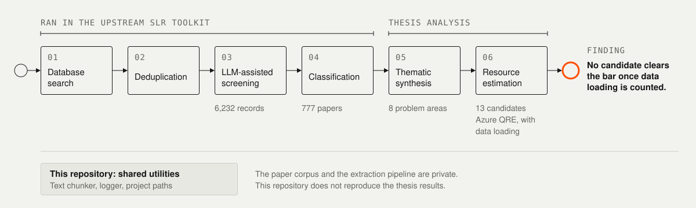

# Quantum Finance

Does gate-based quantum computing give finance a practical advantage yet? Not yet, and the
bottleneck is loading classical data, not the algorithms. This repository is the public edition
of our MSc thesis, with the shared utilities from the research.

> [!NOTE]
> **Reference only.** Curated public edition of a completed MSc thesis. It does not include the paper corpus or reproduce the thesis results.

## Overview

We wrote the thesis at Copenhagen Business School. It asks if gate-based quantum computing
delivers practical advantage in finance. We reviewed the literature systematically and then
costed the leading candidates. The thesis PDF is not published in this repository.

## Method

We followed a pipeline from the literature to a resource estimate:

1. **Database search** for relevant records.
2. **Deduplication** of the records.
3. **LLM-assisted screening** of 6,232 records. Several LLMs supported this step.
4. **Classification** of the 777 papers that remained.
5. **Thematic synthesis** across eight problem areas. Several LLMs supported this step too, in an AI-supported thematic-analysis workflow.
6. **Resource estimation** of the 13 leading candidates with Azure's Quantum Resource Estimator.
   The estimate includes the cost of loading classical data.

Steps 1 to 4 ran in the upstream systematic-review toolkit. Reproducibility stops at the
utilities in this repository. The paper corpus and the extraction pipeline are private. See
[methodology and limitations](docs/methodology.md).

<picture>
  <source media="(prefers-color-scheme: dark)" srcset="docs/diagrams/research-pipeline-dark.svg">
  
</picture>

## Result

None of the 13 candidates clears the practical-advantage bar once the cost of loading data is
counted. Quantum finance is an integration problem rather than a list of algorithms.

## Related repositories

| Repository | Role |
| --- | --- |
| [quantum-finance-slr](https://github.com/vallahrich/quantum-finance-slr) | Systematic-review toolkit: searching, ingestion, deduplication, screening, and topic coding. |

The extraction pipeline is kept private.

The upstream toolkit has its own history, dependencies, and setup instructions.
Its files are not bundled here, and this release's publication review does not
cover its contents or history.

## Contributors

The thesis was co-authored by Aleix Moreno Telesforo
([TelesforoAleix](https://github.com/TelesforoAleix)) and Vincent Wallerich
([vallahrich](https://github.com/vallahrich)). Aleix was a substantial contributor
to the parent research repository. Its development history also credits
[superman32432432](https://github.com/superman32432432).

This edition starts with a new Git history, so its contributor graph does not
represent the original collaboration.

## For agents and operators

### Quick start

Use Python 3.12+ from the repo root. The default path uses the standard library
and needs no API credentials. Run the utility tests:

```bash
git clone https://github.com/TelesforoAleix/quantum-finance.git && cd quantum-finance
python3 -m unittest discover -s tests -v
```

Token budgeting falls back to approximately four characters per token. Optional
`tiktoken` enables tokenizer-based counting and may download tokenizer data.
Utilities write logs under `logs/`, which is excluded from version control.

### Included utilities

- [Text chunker](shared/tools/text_chunker.py): section-aware chunking and token-budget truncation.
- [Logger](shared/tools/logger.py): structured local logging with revision metadata.
- [Paths](shared/tools/_paths.py): project-root discovery with an environment override.

### Publication scope

This is a curated code and documentation release. Papers, extracted article text,
manuscripts, reviewer material, research datasets, credentials, configurations,
caches, and generated model outputs are excluded. The original research history
is retained privately.

See [publication scope](docs/publication-scope.md) for the release boundary and
checks. Included code and documentation retain the original [MIT license](LICENSE).
